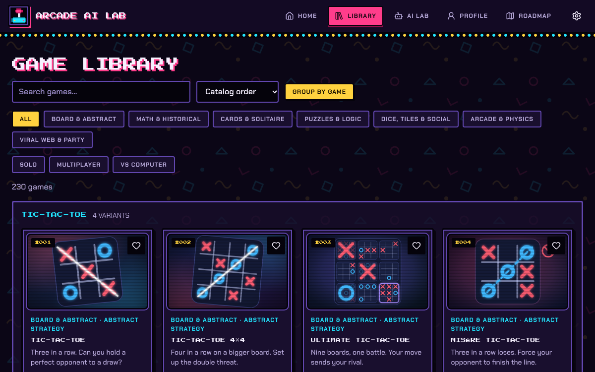
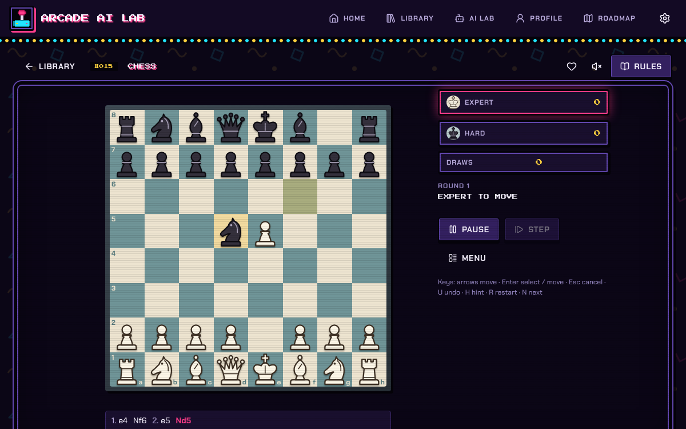
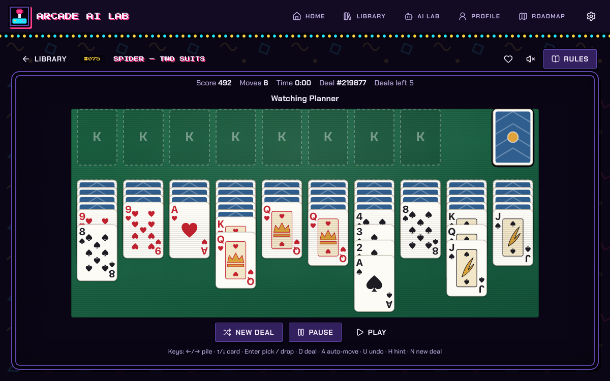
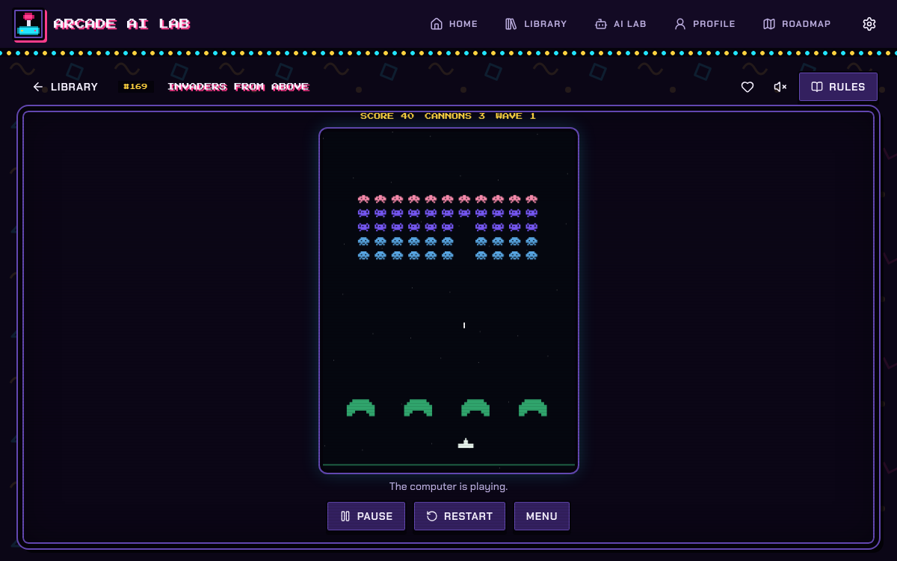
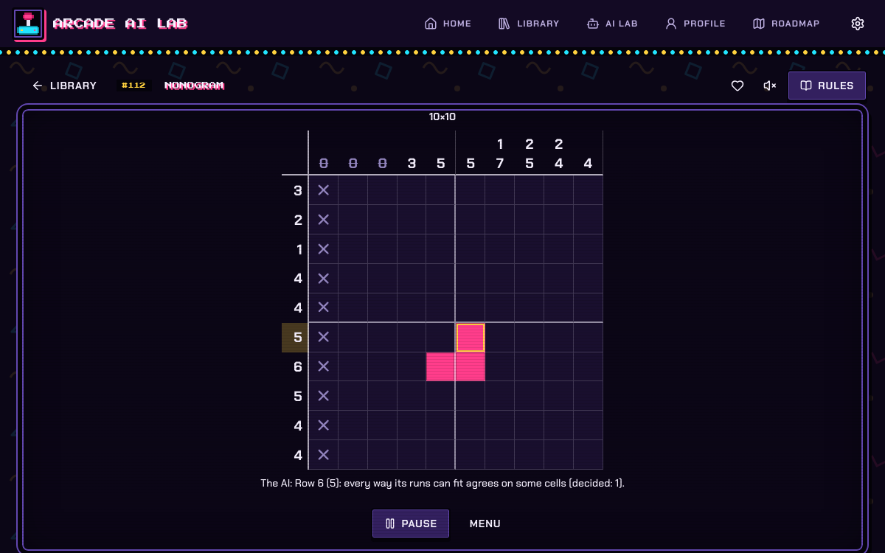
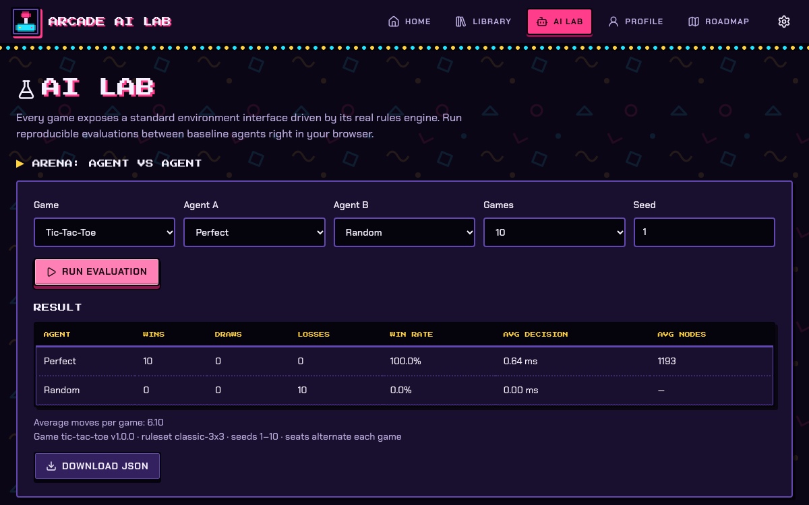
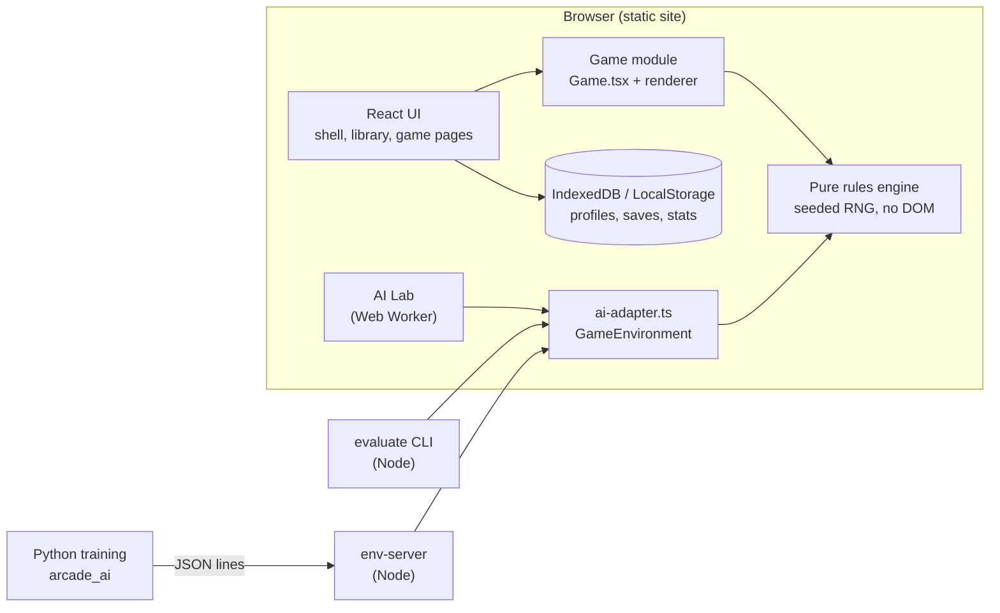

<p align="center">
  <a href="https://ale-newport.github.io/Games/">
    
  </a>
</p>

<h1 align="center">Arcade AI Lab</h1>

<p align="center">
  <strong>244 fully playable browser games, from chess and go to solitaire and arcade, each built on a pure, seeded rules engine that is also a ready-made AI research environment.</strong>
</p>

<p align="center">
  <a href="https://ale-newport.github.io/Games/"></a>
</p>

<p align="center">
  <a href="https://github.com/Ale-Newport/Games/actions/workflows/ci.yml"></a>
  <a href="https://github.com/Ale-Newport/Games/actions/workflows/codeql.yml"></a>
  <a href="https://github.com/Ale-Newport/Games/releases/latest"></a>
  <a href="LICENSE"></a>
  <a href="docs/ROADMAP.md"></a>
  
  
  
</p>

<p align="center">
  <a href="https://ale-newport.github.io/Games/"><b>Play now</b></a> ·
  <a href="#features">Features</a> ·
  <a href="#ai-research-core">AI research core</a> ·
  <a href="#quick-start">Quick start</a> ·
  <a href="docs/ROADMAP.md">Full catalog</a> ·
  <a href="CONTRIBUTING.md">Contributing</a>
</p>

---

## Why Arcade AI Lab?

- **Real games, not demos.** Every game implements its full ruleset, all of its modes and levels,
  computer opponents at several difficulties, undo, saves and statistics. Nothing is marked
  complete until it passes a [written definition of done](docs/game-standards.md).
- **Free, private, instant.** It is a static site: no account, no ads, no tracking, no server.
  Open the link and play on desktop or phone.
- **Built for AI research.** The same engine that powers the UI is exposed through one
  `GameEnvironment` interface with seeded randomness, explicit chance nodes, information-set
  observations and fixed action encodings, so you can benchmark MCTS, minimax, CFR or your own
  reinforcement-learning agent on 244 games without writing a simulator.

## Features

| Family                                    | Games | Examples                                                                 |
| ----------------------------------------- | ----: | ------------------------------------------------------------------------ |
| Classic board & abstract strategy         |    40 | Chess, Chess960, shogi, xiangqi, janggi, go 9×9–19×19, draughts, hex     |
| Mathematical, historical & extra strategy |    30 | Nim, Chomp, Hnefatafl, Fanorona, Kalah, Oware, Game of the Amazons       |
| Card & solitaire                          |    30 | Klondike, Spider, FreeCell, hearts, spades, bridge, Texas hold'em        |
| Puzzles, logic & solving                  |    40 | Sudoku variants, nonograms, Sokoban, calcudoku, 3×3 twisty cube          |
| Dice, dominoes, chance & social           |    25 | Backgammon, five dice, Farkle, dominoes, Ludo, Parchís, Royal Game of Ur |
| Arcade, platformers & physics             |    35 | Space Rocks, invaders, brick breaker, platformers, lunar lander, racing  |
| Viral web, word & party games             |    30 | Daily word games, word-vector games, geography quizzes, doodle guessing  |
| Guessing & daily challenges (in progress) |    14 | Graph forecasts, price guessing, year timelines, one-star landmarks      |

- **Watch the AI play** any game (`?mode=watch`), with step-by-step explanations in the puzzle
  solvers.
- **English and Spanish**, dark and light themes, a colorblind palette and reduced motion.
- **Keyboard, mouse and touch** in every game, responsive down to 360 px wide phones.
- **Profiles, statistics, achievements and saves** stored locally (IndexedDB, versioned and
  validated).
- **Original art and sound.** All graphics are hand-authored SVG, CSS or canvas, and all sound
  effects are synthesized at runtime with the Web Audio API. Third-party data is listed in
  [docs/asset-licenses.md](docs/asset-licenses.md).

<table>
  <tr>
    <td></td>
    <td></td>
  </tr>
  <tr>
    <td align="center"><sub>Library grouped by family, with search and filters</sub></td>
    <td align="center"><sub>Chess: full rules, clocks and four engine levels</sub></td>
  </tr>
  <tr>
    <td></td>
    <td></td>
  </tr>
  <tr>
    <td align="center"><sub>Solitaires with hints, undo and a planning AI</sub></td>
    <td align="center"><sub>Arcade games run on a fixed-step simulation</sub></td>
  </tr>
  <tr>
    <td></td>
    <td></td>
  </tr>
  <tr>
    <td align="center"><sub>Puzzle solvers explain their deductions</sub></td>
    <td align="center"><sub>AI Lab: reproducible agent-vs-agent evaluations</sub></td>
  </tr>
</table>

## AI research core

Every game ships an `ai-adapter.ts` that wraps its real rules engine in the
[`GameEnvironment` contract](docs/ai-integration.md): deterministic `reset(seed)`, legal actions,
pure `applyAction`, per-player observations that never leak hidden information, outcomes and
rewards, exact serialization, and optional chance distributions and tensor encodings. A shared
contract test suite runs against all 244 adapters.

```ts
import { loadAiBundle } from './src/ai/adapters/registry';
import { Rng } from './src/core/game-engine/random';

const { env, agents } = await loadAiBundle('four-in-a-row');
const agent = (id: string) => agents.find((a) => a.id === id)!.create();
const seats = [agent('hard'), agent('random')];
const rng = new Rng(7);

let state = env.reset(7);
while (!env.isTerminal(state)) {
  const player = env.getCurrentPlayer(state);
  state = env.applyAction(state, seats[player]!.selectAction(env, state, player, { rng }));
}
console.log(env.getOutcome(state)); // { returns: [1, -1], winners: [0], draw: false, reason: 'line' }
```

Reproducible head-to-head evaluation from the command line (JSON report with win rates,
latency and search nodes):

```bash
npm run evaluate -- tic-tac-toe perfect random 100 1
# perfect: 87 wins, 0 losses, 13 draws · random: 0 wins, 87 losses, 13 draws
```

Python can drive the same engines through a JSON-lines bridge, with no second simulator to keep
in sync ([training/README.md](training/README.md)):

```bash
python3 training/scripts/random_rollouts.py --game four-in-a-row --episodes 200 --seed 1
```

Baseline agents include random, Monte Carlo tree search, alpha-beta, counterfactual regret
minimization (for poker variants), exact solvers for small games and hand-tuned heuristics per
game. The in-browser **AI Lab** runs evaluations in a Web Worker and keeps a history you can
download as JSON.

## Quick start

Requirements: Node.js 22.18+ and npm 10+.

```bash
git clone https://github.com/Ale-Newport/Games.git && cd Games && npm ci && npm start
```

Then open <http://localhost:5173>. For browser tests, install Chromium once with
`npx playwright install chromium`.

| Command                                                       | Description                                       |
| ------------------------------------------------------------- | ------------------------------------------------- |
| `npm start` / `npm run dev`                                   | Development server                                |
| `npm run build`                                               | Typecheck and build the static site into `dist/`  |
| `npm run preview`                                             | Serve the production build on port 4173           |
| `npm run lint` / `npm run format`                             | ESLint / Prettier                                 |
| `npm run typecheck`                                           | TypeScript project check                          |
| `npm test`                                                    | Unit, AI-contract and roadmap tests (Vitest)      |
| `npm run test:game -- <id>`                                   | Tests for one game, e.g. `sokoban`                |
| `npm run test:e2e`                                            | Playwright browser tests (desktop + mobile)       |
| `npm run verify`                                              | Everything CI runs, in order                      |
| `npm run evaluate -- <game> <agentA> <agentB> [games] [seed]` | Reproducible agent evaluation (JSON)              |
| `npm run env-server`                                          | JSON-lines environment server for Python training |
| `npm run media`                                               | Re-record the README GIF, screenshots and preview |
| `npm run roadmap`                                             | Regenerate [docs/ROADMAP.md](docs/ROADMAP.md)     |

## Architecture



- `src/app/` shell, hash router and pages · `src/components/` shared UI
- `src/core/` platform services: seeded random, input, audio, persistence, profiles,
  achievements, replays, i18n, fixed-step game loop
- `src/games/<id>/` one self-contained, code-split module per game, plus `src/games/shared/` for
  families (chess, go, cards, solitaire, two-player match shell…)
- `src/ai/` environment contract, contract tests, agents and evaluation
- `tools/` Node scripts · `training/` Python bridge · `tests/` platform and Playwright tests

Details: [architecture](docs/architecture.md) · [definition of done](docs/game-standards.md) ·
[AI integration](docs/ai-integration.md) · [asset licenses](docs/asset-licenses.md) ·
[catalog and status](docs/ROADMAP.md)

## Deployment

Every push to `main` runs lint, format, typecheck, unit tests (sharded), the production build and
Playwright on desktop and mobile (sharded), then deploys `dist/` to GitHub Pages. The build uses
relative paths and hash routing, so it works unchanged at `https://<user>.github.io/` or
`https://<user>.github.io/<repo>/`, or on any static host. Each
[release](https://github.com/Ale-Newport/Games/releases) attaches the built site as a zip.

To host your own copy: fork the repository, enable **Settings → Pages → Source: GitHub Actions**,
and push to `main`.

## Privacy and security

Everything stays in your browser: settings in LocalStorage; profiles, statistics and saves in
IndexedDB. There are no accounts, analytics, cookies or network calls beyond loading the site
itself, and production builds enforce a strict Content-Security-Policy. To report a
vulnerability, see [SECURITY.md](SECURITY.md).

## Contributing

Bug reports, translations, accessibility fixes, puzzle content and stronger agents are very
welcome. Start with [CONTRIBUTING.md](CONTRIBUTING.md) and the
[good first issues](https://github.com/Ale-Newport/Games/labels/good%20first%20issue), or say hi
in [Discussions](https://github.com/Ale-Newport/Games/discussions). Please follow the
[Code of Conduct](CODE_OF_CONDUCT.md).

## License and acknowledgements

Code is released under the [MIT License](LICENSE). Bundled data keeps its own license:
doodles from the [Quick, Draw! dataset](https://github.com/googlecreativelab/quickdraw-dataset)
(Google, CC BY 4.0), word vectors derived from [GloVe](https://nlp.stanford.edu/projects/glove/)
(PDDL), Spanish word vectors derived from
[fastText](https://fasttext.cc/docs/en/crawl-vectors.html) (Grave et al. 2018, CC BY-SA 3.0),
country shapes from [Natural Earth](https://www.naturalearthdata.com/) (public domain),
and the Chakra Petch and Press Start 2P fonts (SIL OFL 1.1). Game names are generic and all art,
levels and sounds are original; this project is not affiliated with any commercial game.
